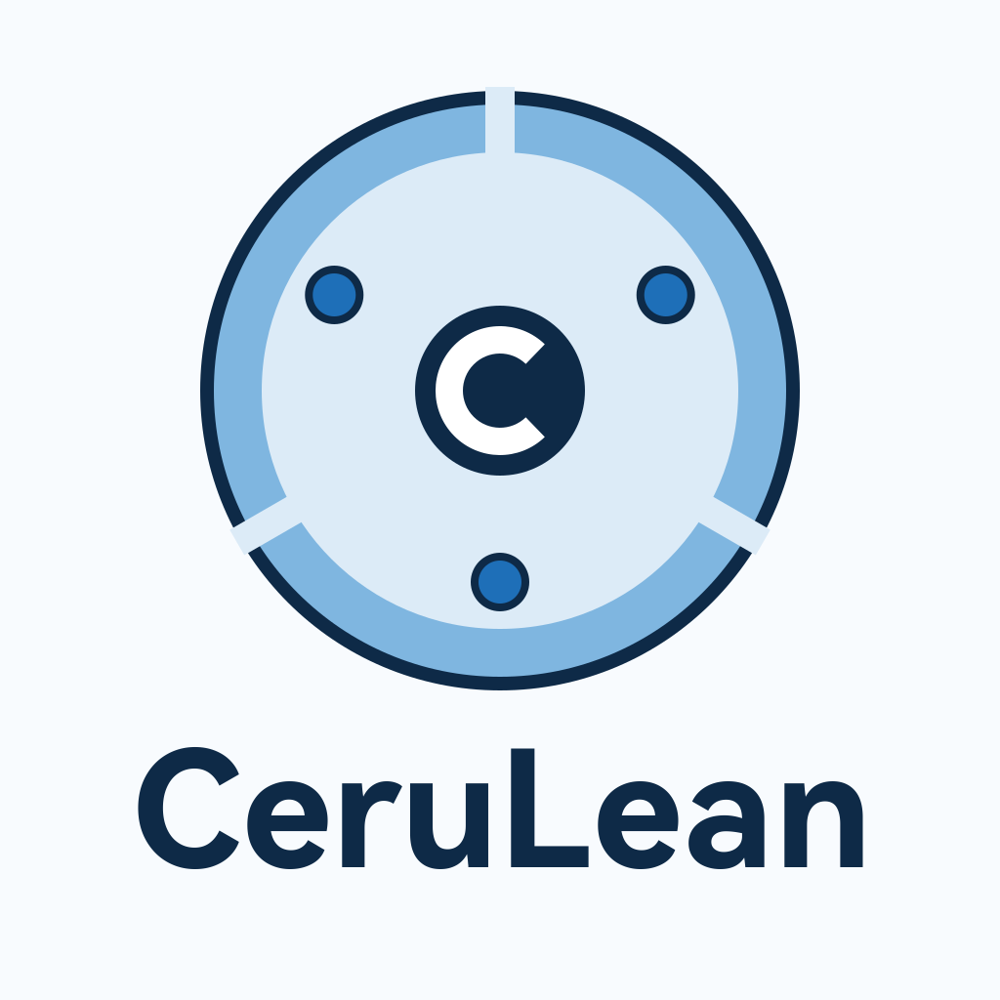

<div align="center">
  
  <h1>CeruLean Cores</h1>
  <p><b>面向「半投入生产」的 Minecraft 服务端发行版</b><br>
  以 Folia 26.3 为基座 · 补上区域化之下被牺牲掉的跨区域游戏语义</p>
  <p>
    <code>Minecraft 26.3</code> · <code>Java 25</code> · <code>GPLv3</code> · 构建形态：paperweight patch-only fork
  </p>
  <p>
    <b>本期版本：<code>26.3-SNAPSHOT</code>（Snapshot，按 pre-release 发布，不建议用于生产）</b><br>
    发布 tag 约定 <code>v26.3-build.N</code> · 详见 <a href="docs/18-版本与发布约定.md">docs/18</a>
  </p>
</div>

---

## 这是什么

CeruLean Cores 是一个 Minecraft Java 版服务端发行版，**基座是 [Folia](https://github.com/PaperMC/Folia) 26.3**。

它不是在问"区域化怎么做"——那件事上游已经做完了。它问的是**下一个问题**：

> 世界被切成多个区域、每个区域在自己的线程上独立推进 tick 之后，
> **那些天生要跨越区域的游戏语义**（最典型的是命令方块链）**还剩多少？怎么补回来？**

Folia 对这个问题的回答是**取舍**：关掉、或者不注册那些无法保证区域安全的入口。
CeruLean 的回答是**把它们做成区域安全的再放开**。本仓库的主要内容就是这件事的施工记录与验收证据。

## 与上游的分工

| | 由谁提供 |
|---|---|
| 区域化运行时：`ThreadedRegionizer` / `TickRegionScheduler` / region-aware `TickThread` / `RegionizedServer` 与区域任务队列 / region profiler / watchdog | **Folia 26.3 上游**（补丁已 vendor 进本仓库为 `0001`–`0011`） |
| 区块系统、Moonrise、构建形态（paperweight patch-only fork） | **Paper 主线**（由 `gradle.properties` 的 `paperRef` 锁定） |
| **被 Folia 为区域安全而下架的入口，重新做成区域安全后放开** | **本项目**（补丁 `0012` 起） |
| **跨区域投递原语、并发加固、可挂起命令方块链（EXP）** | **本项目** |
| **分层验收套件（同时是发布闸门）** | **本项目** |

具体补了什么（每一条都有实测验收记录，见文末文档索引）：

- **命令层复活**。Folia 把 `data` / `scoreboard` / `clone` 的注册注释掉了（`Commands.java` 里的 TODO）。
  本项目的做法是先找出真正的约束——**世界访问必须发生在"正在 tick 该 level 的区域线程"上**
  （`Level.getCurrentWorldData()` 在别的线程上返回 `null`，在别的维度的区域线程上抛 `World mismatch`）——
  再把世界访问整体推迟进投递体。`clone` 还额外做了**两跳**（源区域读 → 目标区域写）与**方块刻快照**，
  因此跨区域与**跨维度**都能真的拷到位。
- **投递原语** `AwaitableDispatch`：`dispatch()` 非阻塞（写路径一律用它）、`call()` 有界等待
  （只有"命令契约要求同步返回值"的读取才用）。并实测出一个结构性隐患并做了防护：
  **当 Folia 调度器只有 1 个线程时，global region 与目标区域跑在同一线程上，同步等待等于等自己**——
  现在会快速失败并给出可诊断的错误，而不是把 global region 拖停到触发 watchdog。
- **并发加固**。`Scoreboard` 是跨区域共享、本来没有任何同步的容器，而它在放开命令**之前**
  就已经被区域线程写了（`ServerPlayer.awardStat/awardKillScore/handleTeamKill/…`）。已换成并发容器
  并加一把只保护复合操作的稀疏锁（通知移到锁外，热读不上锁）。
- **可挂起命令方块链（EXP）**——见下一节。

## EXP 链是什么

Folia 把命令方块**整个关掉**了：`BaseCommandBlock.performCommand` 的第一行就是
`if (true) return false;`。理由很直接——一条命令方块链是**跨区域的连续动作**（一块执行完接着下一块），
而那块方块完全可能属于别的区域。

**EXP 链**（本项目的命名，来自上一代项目）把这条链当作一段**可挂起、可恢复的事务**来处理：

```
walk 沿链前进
  └─ 遇到需要跨区域完成的动作（例如 setblock 到别的区域）
        → 登记为延迟工作，攒进"按目标区域分组"的批次
        → 到批边界（条件块 / 批次上限 / 链尾）**挂起**：
          存下 Continuation（光标位置、朝向、剩余步数、阶段快照）
        → 派发到各目标区域执行
        → 全部完成后回 home 区域**恢复**，从断点继续走
```

这样"链"在语义上仍然是连续的一条，而每一步都发生在正确的区域线程上。
配置开关是 `command_blocks.mode`：`SAFE`（默认，保持 Folia 的禁用行为）/ `ACCESS` / `EXP`。

**EXP 的完整实现与演进史在另一个仓库：[XCxyTianQ/AzureBranches](https://github.com/XCxyTianQ/AzureBranches)**
——那是同作者的上一代项目（Folia 26.1.2 基座），经历了 13 站演进（EXP5Plus → EXP7，含自研存储引擎）。
上代项目里 EXP 的**协议状态作用域（OCC）**部分是构建期注入的 554 行，依赖本仓库没有的
`RegionCommandExecutor`；**OCC 在本期明确排除**，因此本项目目前实现的是 **EXP v2 语义**
（挂起/恢复 + 阶段快照 + 批边界派发），验收口径也相应地窄于上代项目的 `exp6/exp6plus` 用例。

## 当前状态

> 本期（2026-10-16 起）服务端核心为 **Snapshot**，按 GitHub **pre-release** 发布，不建议用于生产。
> 版本串与发布链路的约定见 [docs/18](docs/18-版本与发布约定.md)。

| 能力 | 状态 |
|---|---|
| 基座 | ✅ Folia 26.3（`paperRef`/`mcVersion` 在 `gradle.properties` 里锁定） |
| 构建链路 | ✅ `applyAllPatches` + `:cerulean-server:createPaperclipJar`，Java 25 上产出 paperclip 分发 jar |
| 发行物可复现校验 | ✅ 自带工具可复现上游/自家分发链并逐字节校验（含篡改自检） |
| 命令复活 | ✅ `data` / `scoreboard` / `clone`；clone 支持跨区域与**跨维度**两跳 + 方块刻搬运 |
| 命令方块 | ✅ 配置模式开关（SAFE 默认 / ACCESS / EXP）；**矿车（`MinecartCommandBlock`）回归未覆盖** |
| EXP 可挂起链 | ✅ EXP v2 语义接入并实测（SAFE 与 EXP 两种模式各起一次服验收）；**OCC 明确排除** |
| 并发加固 | ✅ Scoreboard 并发容器 + 稀疏锁；**真跨区域并发压测受环境限制未做**（见下） |
| 验收套件 | ✅ L0/L1/L2 分层（`tools/smoke/run_suite.py`），同时是**发布闸门** |
| 已知限制 | ⚠️ ① 同步跨区域读取要求 Folia 调度器 **≥2 个线程**（否则自锁，套件记「未验证」而非通过）；② 链的挂起/恢复路径需要 ≥2 个区域才能构造，当前冒烟环境是单区域；③ 命令方块矿车未回归；④ EXP 的 OCC 部分未做 |

**这些限制都写在验收记录里，不含糊过去。** 每一条都能在文末的文档索引里找到对应的实测证据。

## 快速开始

### 要求

- **JDK 25**（Minecraft/Paper 26.x 的 class 主版本为 69，无降级空间）
- Git、约 3 GB 磁盘（反编译源码 + Gradle 缓存）
- 首次构建需要网络（拉取上游仓库与 Gradle 发行包）

### 构建

```sh
# 1) 拉取上游到 pin 的提交 + 反编译 + 应用全部补丁（Folia 与我们自己的）
./gradlew applyAllPatches

# 2) 产出 paperclip 分发 jar（对外发行物）
./gradlew :cerulean-server:createPaperclipJar

# 3) 运行
java -Xmx4G -jar cerulean-server/build/libs/cerulean-paperclip-*.jar --nogui
```

**在 HarmonyOS PC 上**（本项目的主要开发机）请改用 `tools/gradle-local.sh`：该环境的 `gradlew`
脚本会把默认 JVM 参数错当主类、且 Java 侧无法完成 Gradle 发行包的下载重定向。
细节与绕行方式见 [docs/03-构建接入.md](docs/03-构建接入.md)。

## 验收

验收分三层，统一入口是 `tools/smoke/run_suite.py`：

| 层 | 回答什么问题 | 内容 |
|---|---|---|
| **L0** | 基座活着吗 | 区域调度线程数、各 world 的区域拓扑、区块加载后区域是否出现 |
| **L1** | 基座把自己的状态报出来了吗、有没有在报警 | 上游的区域级 `/tps`、内置 spark、`/paper` 命令面、watchdog 无"区域停摆"告警，加上我们自己的诊断命令（`/cerulean regions\|regionat\|dispatch\|exp`） |
| **L2** | 具体用例行为对不对 | scoreboard+clone（含跨维度真拷）、EXP 链（SAFE/EXP 两轮起服）、scoreboard 顺序压力、存档往返 |

```sh
export CERULEAN_EULA=TRUE RCON_PORT=25575 RCON_PASSWORD=test1234
python3 tools/smoke/run_suite.py            # L0 + L1 + L2 全跑
```

**退出码约定**：子项 `0`=通过、`1`=失败、**`2`=环境前提不满足（未验证）**。
「未验证」在汇总里单列，**既不算通过也不算失败**——不允许用 exit 0 假装通过。

发布工作流 `.github/workflows/release.yml` 会把上面这套套件当作**发布闸门**：
打 tag → 构建 → 跑套件 → 全绿才建 pre-release。

## 项目结构

```
CeruLean/
├── build.gradle.kts / settings.gradle.kts     paperweight patcher 配置（patch-only fork）
├── gradle.properties                          上游 pin（mcVersion / paperRef / 版本通道）
├── cerulean-server/                           服务端侧补丁
│   └── minecraft-patches/features/            0001–0011 = vendor 进来的 Folia 补丁
│                                              0012–      = 本项目自己的补丁
├── cerulean-api/                              API 侧补丁
├── cerulean-checkstyle/                       代码风格模块适配（Paper 26.3 新增该模块）
├── cerulean-regions/                          非补丁的自研代码（编译进 cerulean-server）
│   ├── io/cerulean/regions/                   跨区域投递原语 + 诊断命令
│   └── com/azurebranches/                     EXP 链支撑库（纯 JDK，零 MC import）+ 配置
├── regionizer-core/                           【已归档】自研区域化内核（原 C1 路线，已收缩，不参与构建）
├── tools/
│   ├── verify/                                上游复现与漂移校验（零依赖，单文件 Java）
│   ├── smoke/                                 分层验收套件 + 测试服务器启停（RCON 驱动）
│   ├── icon/                                  图标：SVG 生成器 + SVG→PNG 栅格化器
│   └── gradle-local.sh                        本机 Gradle 启动器（HarmonyOS 绕行）
├── docs/                                      设计、约束、手册、执行与验收记录
└── study/                                     Folia 源码阅读区（阅读笔记 + 参考源码副本，不参与构建）
```

## 验证工具

```sh
# 复现上游发行物并逐字节校验（容器 → 原版 → 内层 jar → 补丁 → 输出）
tools/verify/cerulean-verify upstream --version 26.3

# 证明校验器不是空转：篡改补丁/依赖库必须被检出
tools/verify/cerulean-verify selftest --version 26.3

# 类级漂移报告（用于评估上游改动影响面）
tools/verify/cerulean-verify diff <jarA> <jarB>
```

## 与上游的关系

- 构建形态与 [PaperMC/Folia](https://github.com/PaperMC/Folia) 相同（paperweight patch-only fork），
  **Folia 26.3 是本项目的基座**：它的补丁被 vendor 进 `cerulean-server/minecraft-patches/features/0001–0011`，
  本项目的补丁从 `0012` 开始。
- 上游层叠：`Mojang server.jar → Paper（paperRef 锁定）→ Folia 26.3 → CeruLean`。
- **EXP 链的语义目标与实现史继承自同作者的上一代项目
  [AzureBranches](https://github.com/XCxyTianQ/AzureBranches)**（Folia 26.1.2 基座，13 站演进）。
  本项目移植的是它的 **EXP v2** 部分；OCC 部分（构建期注入、依赖 `RegionCommandExecutor`）明确排除。
- `study/` 下的 Folia 源码是**阅读用参考副本**，不参与构建。

完整的衍生关系、许可证与 Minecraft EULA 声明见 **[NOTICE.md](NOTICE.md)**。

## 许可证

**GPLv3** —— 继承链：`Bukkit / CraftBukkit → Spigot → Paper → Folia → AzureBranches → CeruLean`。
分发时必须附完整对应源码（含全部补丁）并保留 [NOTICE.md](NOTICE.md)。详见 [LICENSE](LICENSE)。
